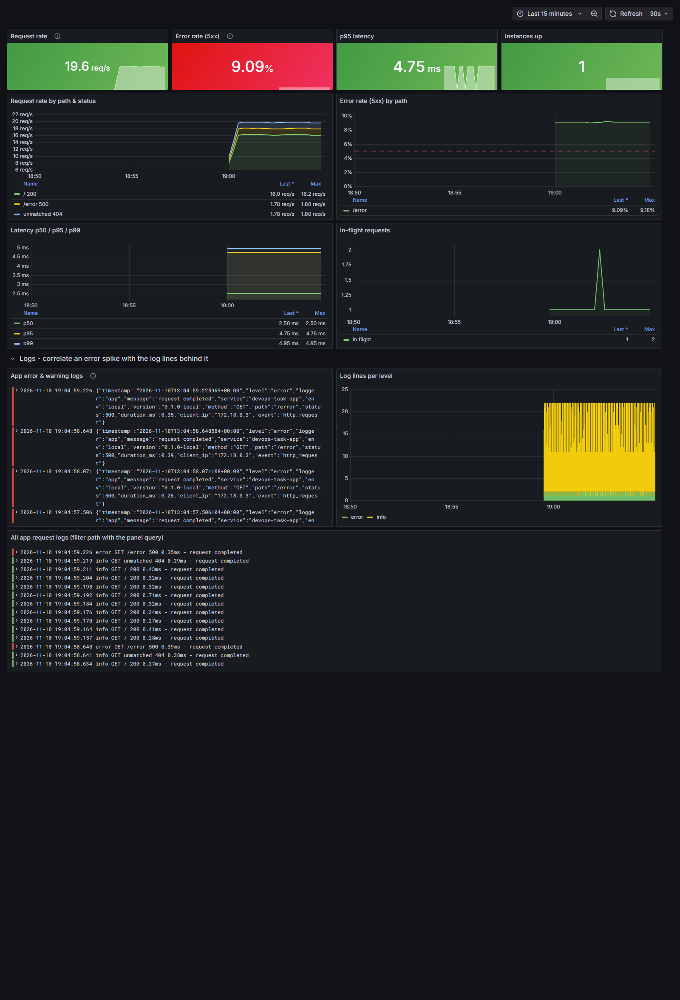
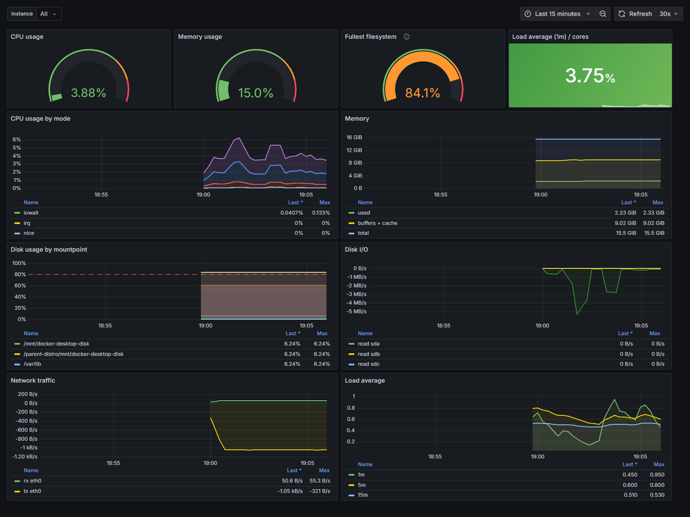
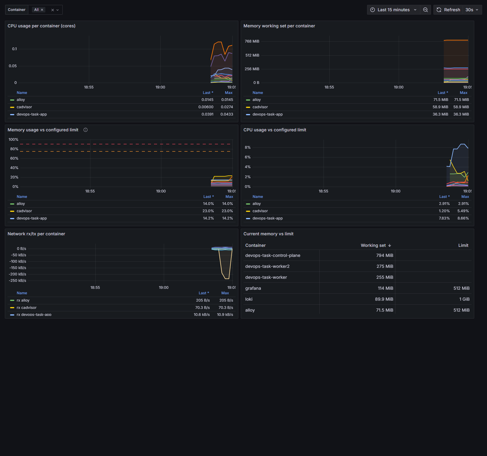
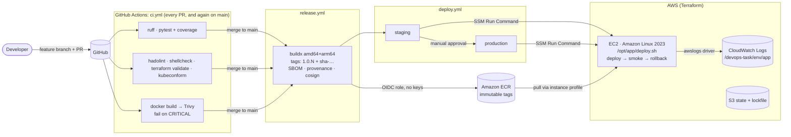
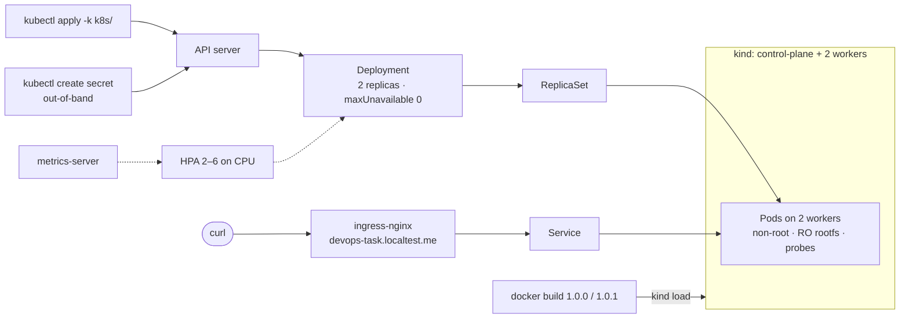
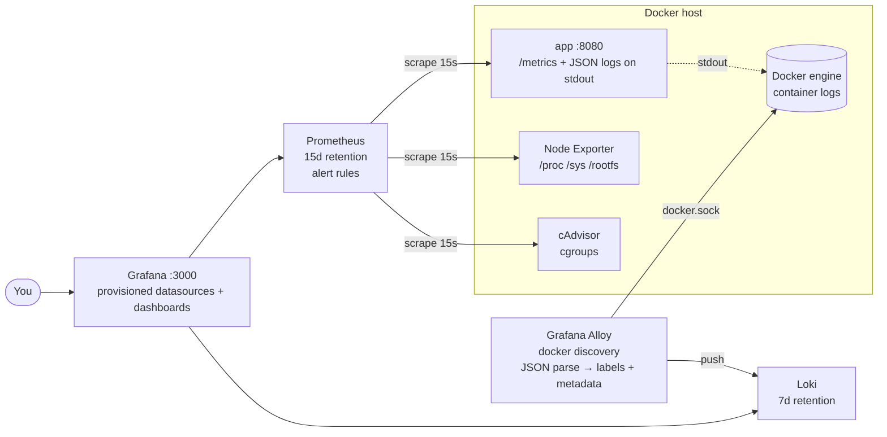

# DevOps Task: from source to an observable, securely deployed service

A small Python (FastAPI) web service taken end to end:

| Area | What is in this repo |
|---|---|
| App | `GET /`, `GET /health`, `GET /metrics`; config from env vars; JSON logs; graceful SIGTERM; unit tests (97% coverage) |
| Container | Multi-stage, **distroless**, digest-pinned, non-root image (**95.4 MB**) with HEALTHCHECK and OCI labels |
| CI/CD | GitHub Actions: lint, test, coverage, hadolint, shellcheck, Terraform/K8s validation, Trivy gate → multi-arch build → ECR (OIDC, no keys) → SSM deploy to EC2 → smoke test → automatic rollback |
| IaC | Terraform: S3 remote state with native locking, ECR + GitHub OIDC role, EC2 + least-privilege instance profile + CloudWatch Logs, staging/production via tfvars |
| Kubernetes | Kustomize manifests for kind: Deployment, Service, Ingress, ConfigMap, Secret, HPA, PDB, restricted securityContext; demonstrated zero-downtime rollout and `rollout undo` |
| Observability | Prometheus, Grafana, Loki, Grafana Alloy, Node Exporter, cAdvisor, all provisioned as code; 3 dashboards; 6 alert rules |
| Automation | `system_health.sh` with thresholds, JSON output, exit codes, log rotation, cron and systemd timer |

---

## Contents

1. [Repository layout](#repository-layout)
2. [Quick start (app + observability stack)](#quick-start)
3. [Running the tests](#running-the-tests)
4. [The application](#the-application)
5. [Container image](#container-image)
6. [CI/CD pipeline](#cicd-pipeline)
7. [Terraform (AWS)](#terraform-aws)
8. [Kubernetes (kind)](#kubernetes-kind)
9. [Observability stack](#observability-stack)
10. [Linux automation: system_health.sh](#linux-automation-system_healthsh)
11. [Architecture](#architecture)
12. [Design decisions](#design-decisions)
13. [Deployment & rollback strategy](#deployment--rollback-strategy)
14. [Security considerations](#security-considerations)
15. [AWS cost estimate](#aws-cost-estimate)
16. [What I would improve with more time](#what-i-would-improve-with-more-time)
17. [Use of AI tools](#use-of-ai-tools)

---

## Repository layout

```
.
├── app/                          FastAPI service (main, config, logging, metrics)
├── tests/                        pytest unit tests
├── Dockerfile, .dockerignore     production image
├── docker-compose.yml            app only (port 8080)
├── docker-compose.monitoring.yml Prometheus, Grafana, Loki, Alloy, Node Exporter, cAdvisor
├── .github/workflows/            ci.yml (PR gates), release.yml (main), deploy.yml (reusable deploy)
├── terraform/
│   ├── bootstrap/                S3 state bucket (one-time, local state)
│   ├── global/                   ECR repo, GitHub OIDC provider, CI role
│   └── app/                      EC2 target per environment (envs/staging|production.*)
├── k8s/                          Kustomize manifests + kind cluster config
├── monitoring/                   prometheus/, loki/, alloy/, grafana/ (provisioning + dashboards)
├── scripts/
│   ├── deploy.sh                 host-side deploy/smoke/rollback helper (installed on EC2)
│   ├── ssm-run.sh                runs a command on an environment's EC2 via SSM (used by CI)
│   ├── k8s-rollout-demo.sh       zero-downtime rollout + rollback demo
│   └── system_health.sh          Step 6 health check
├── deploy/                       systemd service/timer and cron entry for system_health.sh
└── docs/                         screenshots and captured command output
```

---

## Quick start

### Prerequisites

| Tool | Version used | Needed for |
|---|---|---|
| Docker + Docker Compose v2 | Docker 29.x, Compose 5.x | app and observability stack |
| Python | 3.11 | running tests outside Docker (optional) |
| kind, kubectl | kind 0.31, kubectl 1.34 | Kubernetes section |
| Terraform | ≥ 1.10 | AWS section |
| AWS CLI v2 | 2.x | AWS section |

### Run the app only

```bash
docker compose up -d --build
curl -s localhost:8080/          # {"message":"Hello from DevOps Task!","status":"running","version":"0.1.0-local"}
curl -s localhost:8080/health    # {"status":"ok"}
curl -s localhost:8080/metrics | head
```

### Run the app + full observability stack

```bash
cp .env.example .env
# edit .env and set GRAFANA_ADMIN_PASSWORD (compose refuses to start Grafana without it)

docker compose -f docker-compose.yml -f docker-compose.monitoring.yml up -d --build
```

Optional demo traffic (normal requests, 404s and, if `ENABLE_CHAOS_ENDPOINT=true` in `.env`, 5xx errors) so the dashboards and alerts have something to show:

```bash
docker compose -f docker-compose.yml -f docker-compose.monitoring.yml --profile demo up -d
```

| URL | What |
|---|---|
| http://localhost:8080 | the app |
| http://localhost:3000 | Grafana: log in with `GRAFANA_ADMIN_USER` / `GRAFANA_ADMIN_PASSWORD` from `.env` |

Dashboards are in **Dashboards → DevOps Task**: *Application* (home dashboard), *Host*, *Containers*.
Prometheus, Loki, Alloy, Node Exporter and cAdvisor are **not** reachable from the host by design; use Grafana → Explore, or `docker compose exec prometheus wget -qO- localhost:9090/api/v1/alerts`.

Stop everything:

```bash
docker compose -f docker-compose.yml -f docker-compose.monitoring.yml --profile demo down      # add -v to delete data volumes
```

---

## Running the tests

```bash
python -m venv .venv && . .venv/bin/activate       # Windows: .venv\Scripts\activate
pip install -r requirements-dev.txt
ruff check . && ruff format --check .
pytest                                             # coverage report printed + coverage.xml
```

Or without a local Python:

```bash
docker run --rm -v "$PWD:/src" -w /src python:3.11-slim-bookworm \
  sh -c "pip install -q -r requirements-dev.txt && ruff check . && pytest"
```

Result: 8 tests passed, **97% coverage**.

---

## The application

| Endpoint | Behaviour |
|---|---|
| `GET /` | `{"message": "Hello from DevOps Task!", "status": "running", "version": "<APP_VERSION>"}` |
| `GET /health` | `{"status": "ok"}`; used for liveness, readiness, Docker HEALTHCHECK and deploy smoke tests |
| `GET /metrics` | Prometheus format: `http_requests_total{method,path,status}`, `http_request_errors_total{method,path}`, `http_request_duration_seconds` histogram, `http_requests_in_progress`, `app_info` |
| `GET /error` | Returns 500 **only** if `ENABLE_CHAOS_ENDPOINT=true` (otherwise 404). Exists to demo alerts/dashboards |

**Configuration** (environment variables only):

| Variable | Default | Purpose |
|---|---|---|
| `PORT` | `8080` | listen port |
| `LOG_LEVEL` | `INFO` | log level |
| `APP_ENV` | `development` | environment name (added to every log line) |
| `APP_VERSION` | `0.0.0-dev` | baked into the image at build time |
| `SHUTDOWN_TIMEOUT_SECONDS` | `10` | max time to drain in-flight requests on SIGTERM |
| `ENABLE_CHAOS_ENDPOINT` | `false` | enables `/error` |

**Metrics cardinality:** the `path` label is the *route template* (e.g. `/`, `/health`), never the raw URL. Unknown URLs are recorded as `path="unmatched"`, so a scanner hitting random URLs cannot create unbounded time series (covered by a unit test).

**Logs:** one JSON object per line on stdout (`timestamp, level, logger, message, service, env, version` plus `method, path, status, duration_ms, client_ip` for requests). Uvicorn's own logs go through the same formatter; its plain-text access log is disabled in favour of the structured one. `/health` and `/metrics` requests are not logged to keep probe/scrape noise out.

**Graceful shutdown:** the container's PID 1 is Python (exec-form `ENTRYPOINT`), so SIGTERM reaches Uvicorn directly. Uvicorn stops accepting connections, drains in-flight requests (bounded by `SHUTDOWN_TIMEOUT_SECONDS`), then runs the FastAPI lifespan shutdown hook, which logs `application shutting down gracefully`:

```
{"level":"info","logger":"uvicorn.error","message":"Shutting down",...}
{"level":"info","logger":"app","message":"application shutting down gracefully","event":"shutdown",...}
{"level":"info","logger":"uvicorn.error","message":"Finished server process [1]",...}
```

---

## Container image

`Dockerfile`:

- **Multi-stage:** `python:3.11-slim-bookworm` installs dependencies into `/install`; only that directory and `app/` are copied into the final stage.
- **Final image:** `gcr.io/distroless/python3-debian12:nonroot`. It has no shell, no package manager and no pip. **Final size: 95.4 MB.**
- **Pinned by digest** (both stages), so a re-pushed tag upstream cannot change the build. Dependabot proposes digest bumps.
- **Non-root:** `USER 65532:65532`. Files are owned by that UID and the app needs no writable paths, so it runs with `read_only: true` in Compose and `readOnlyRootFilesystem` in Kubernetes.
- **HEALTHCHECK:** distroless has no curl/wget, so the probe uses the Python interpreter (`urllib`) against `/health`.
- **OCI labels:** title, description, version, revision (git SHA), created, source and licenses, filled from build args in CI.
- **`.dockerignore`** is an allow-list (`*` then `!app/`, `!requirements.txt`). Tests, `.git`, Terraform state or `.env` can never leak into the build context.

`docker-compose.yml` runs the app on **port 8080** with a health check, `restart: unless-stopped`, CPU/memory limits (`0.5` CPU, `256M`), a read-only filesystem, `cap_drop: [ALL]` and `no-new-privileges`.

---

## CI/CD pipeline

```
.github/workflows/
├── ci.yml        on: pull_request (and reused by release.yml via workflow_call)
├── release.yml   on: push to main
└── deploy.yml    reusable deploy (also manually runnable for an explicit rollback)
```

### On every pull request (`ci.yml`): three parallel jobs

| Job | Steps |
|---|---|
| **Lint, test & coverage** | `ruff check`, `ruff format --check`, `pytest --cov-fail-under=80`, coverage table in the job summary, `coverage.xml` artifact |
| **Static checks** | hadolint (fails on warnings), shellcheck on every `*.sh`, a `system_health.sh` smoke run, `terraform fmt -check` + `validate` for all three stacks, kubeconform on `k8s/` |
| **Build & scan** | Buildx build (GHA layer cache), Trivy HIGH+CRITICAL report (informational), then the **Trivy gate: fails on any fixable CRITICAL vulnerability**, image size in summary |

### On push to `main` (`release.yml`)

```
checks (ci.yml) ──► build-push ──► deploy-staging ──► deploy-production (needs approval)
```

1. **Same gates as PRs.** `main` cannot ship anything a PR would have rejected.
2. **Build multi-arch** `linux/amd64,linux/arm64` with QEMU + Buildx, **layer cache** in the GitHub Actions cache (`type=gha, mode=max`).
3. **Tags:** `<MAJOR.MINOR>.<run_number>` (e.g. `1.0.42`, from the `VERSION` file) **and** `sha-<full git sha>`. No `latest`. The ECR repo has **immutable tags**, so a tag always points to the same digest.
4. **Push to Amazon ECR** using **GitHub OIDC** (`aws-actions/configure-aws-credentials` assumes `devops-task-github-actions`). There are no AWS keys in GitHub.
5. **Supply chain (bonus):** BuildKit **SBOM** and **provenance** attestations, and the image digest is **signed with Cosign** (keyless, Sigstore/OIDC).
6. **Deploy** via `deploy.yml` (see [Deployment & rollback](#deployment--rollback-strategy)): SSM Run Command → `/opt/app/deploy.sh deploy <image>` → smoke test `/health` and version → **automatic rollback** to the previous image if either step fails.

### Required GitHub configuration

There are **no secrets**: AWS access is via OIDC, and Cosign is keyless. Only non-sensitive variables are needed.

| Where | Name | Example | Source |
|---|---|---|---|
| Repo → Settings → Secrets and variables → Actions → **Variables** | `AWS_ROLE_ARN` | `arn:aws:iam::123456789012:role/devops-task-github-actions` | `terraform -chdir=terraform/global output ci_role_arn` |
| same | `AWS_REGION` | `ap-south-1` | |
| same | `ECR_REPOSITORY` | `devops-task-app` | |
| Repo → Settings → **Environments** | `staging` | no protection | |
| same | `production` | **Required reviewers** = you; deployment branch = `main` | gives a manual approval gate before production |

The IAM trust policy only accepts OIDC tokens whose `sub` is `<prefix>:ref:refs/heads/main` or `<prefix>:environment:{staging,production}`, so forks, PRs and other branches cannot assume the role. `<prefix>` is GitHub's *immutable* subject (`repo:ratons127@<owner-id>/devops-task@<repo-id>`), so even a deleted-and-recreated repository with the same name cannot assume it. (My first release failed with `Not authorized to perform sts:AssumeRoleWithWebIdentity` because the policy used the legacy `repo:owner/name` form. CloudTrail showed the real `sub`, and the fix is the `github_oidc_subject_prefix` variable.)

### Evidence

> AWS resources were destroyed after testing (as requested), so the evidence lives here:
>
> - `docs/screenshots/ci-pr.png`: PR checks passing
> - `docs/screenshots/release-run.png`: release workflow: build-push → staging → production
> - `docs/screenshots/deploy-rollback.png`: a deliberately broken release being rolled back
>
> *(Screenshots are added after the pipeline run against my AWS account.)*

---

## Terraform (AWS)

Three stacks with separate state, so a mistake in one environment cannot touch another:

| Stack | State | Creates |
|---|---|---|
| `terraform/bootstrap` | local (one-time) | S3 state bucket: versioning, AES256 encryption, public access block, TLS-only bucket policy |
| `terraform/global` | `s3://<bucket>/global/terraform.tfstate` | ECR repo (immutable tags, scan on push, lifecycle keep 30), GitHub OIDC provider, least-privilege CI role |
| `terraform/app` | `s3://<bucket>/app/<env>/terraform.tfstate` | security group, CloudWatch log group, instance role/profile, EC2 instance with user data |

**State locking** uses S3 native lock files (`use_lockfile = true`, Terraform ≥ 1.10), so no DynamoDB table is needed. A concurrent `apply` fails fast with a lock error.

### Step by step

```bash
export AWS_REGION=ap-south-1
BUCKET=devops-task-tfstate-$(aws sts get-caller-identity --query Account --output text)

# 1. State bucket (once per account)
terraform -chdir=terraform/bootstrap init
terraform -chdir=terraform/bootstrap apply -var "state_bucket_name=$BUCKET"

printf 'bucket = "%s"\nregion = "%s"\n' "$BUCKET" "$AWS_REGION" > terraform/backend.hcl

# 2. Shared resources: ECR + GitHub OIDC + CI role
terraform -chdir=terraform/global init -backend-config=../backend.hcl
# New GitHub repos issue "immutable" OIDC subjects that embed owner/repo IDs
# (repo:owner@123/name@456:...). Read the exact prefix and pin the trust policy to it:
PREFIX=$(gh api repos/ratons127/devops-task/actions/oidc/customization/sub --jq .sub_claim_prefix)
terraform -chdir=terraform/global apply -var "github_repository=ratons127/devops-task" \
  -var "github_oidc_subject_prefix=$PREFIX"
#    (add -var create_github_oidc_provider=false if your account already has the GitHub OIDC provider)

# 3. Staging environment (production is identical with "production")
terraform -chdir=terraform/app init -backend-config=../backend.hcl -backend-config=envs/staging.backend.hcl
terraform -chdir=terraform/app plan  -var-file=envs/staging.tfvars -out=staging.tfplan
terraform -chdir=terraform/app apply staging.tfplan
terraform -chdir=terraform/app output app_url
```

Set `allowed_ingress_cidrs` in `envs/staging.tfvars` to your own IP (`curl ifconfig.me`) before applying.

To switch environments, re-run `init` with `-reconfigure` and the other `envs/*.backend.hcl`.

**Teardown** (reverse order):

```bash
terraform -chdir=terraform/app destroy -var-file=envs/staging.tfvars
terraform -chdir=terraform/global destroy -var "github_repository=ratons127/devops-task"
# the state bucket is kept on purpose (force_destroy = false); empty and delete it manually if wanted
```

### What the instance looks like

- **Amazon Linux 2023** (latest AMI from the public SSM parameter; `ignore_changes = [ami]` so a new AMI does not silently replace the instance).
- **User data** installs Docker, writes `/opt/app/app.env` (region, env, log group), installs `scripts/deploy.sh` as `/opt/app/deploy.sh`, and optionally starts an initial image (normally CI does the first deploy).
- **Security group:** inbound **only TCP 80** from `allowed_ingress_cidrs`. **No SSH port**: administration is via SSM Session Manager / Run Command. Outbound only 443 (ECR, SSM, CloudWatch) and 80 (OS package mirrors).
- **IMDSv2 required, hop limit 1**: containers cannot reach instance credentials through the metadata service.
- **Encrypted gp3** root volume.
- **Logs:** the container uses Docker's `awslogs` driver → log group `/devops-task/<env>/app` with retention **7 days (staging) / 30 days (production)**.

### IAM (least privilege, no static keys anywhere)

| Principal | Allowed |
|---|---|
| EC2 instance role | `AmazonSSMManagedInstanceCore` (SSM agent); ECR **pull** on the app repo only (+ `GetAuthorizationToken`, which AWS does not allow to be scoped); `CreateLogStream/PutLogEvents` on **its own log group only** |
| CI role (OIDC) | ECR push/pull on the app repo only; `ssm:SendCommand` with `AWS-RunShellScript` **only on instances tagged `Project=devops-task`**; read-only `GetCommandInvocation` / `DescribeInstances` |

### Evidence

> - `docs/terraform-plan-staging.txt`: `terraform plan` output
> - `docs/screenshots/terraform-apply.png`: successful apply
>
> *(Added after running against my AWS account; resources destroyed afterwards.)*

---

## Kubernetes (kind)

Manifests are under `k8s/` and applied with Kustomize (`kubectl apply -k k8s/`).

| File | Highlights |
|---|---|
| `namespace.yaml` | `devops-task` namespace enforcing the **restricted** Pod Security Standard |
| `deployment.yaml` | 2 replicas, `RollingUpdate maxUnavailable: 0, maxSurge: 1`; startup/readiness/liveness probes on `/health`; requests `50m/64Mi`, limits `250m/128Mi`; `runAsNonRoot`, UID 65532, `readOnlyRootFilesystem`, all capabilities dropped, seccomp `RuntimeDefault`, no service account token; `preStop` sleep 5s; topology spread across nodes |
| `configmap.yaml` | `PORT`, `LOG_LEVEL`, `APP_ENV`, `SHUTDOWN_TIMEOUT_SECONDS` |
| Secret `devops-task-app-secrets` | **created out-of-band, never committed** (see below) |
| `service.yaml` | ClusterIP :80 → container :8080 |
| `ingress.yaml` | ingress-nginx, host `devops-task.localtest.me` (resolves to 127.0.0.1, no hosts-file edit) |
| `hpa.yaml` | CPU-based, 70% of request, 2 to 6 replicas, 5 min scale-down stabilization |
| `pdb.yaml` | `minAvailable: 1` so node drains never take the app fully down |
| `kind-config.yaml` | 1 control plane + 2 workers, host ports 80/443 → ingress |

### Run it

```bash
kind create cluster --name devops-task --config k8s/kind-config.yaml

# ingress controller + metrics-server (needed by the HPA)
kubectl apply -f https://raw.githubusercontent.com/kubernetes/ingress-nginx/controller-v1.12.0/deploy/static/provider/kind/deploy.yaml
kubectl apply -f https://github.com/kubernetes-sigs/metrics-server/releases/download/v0.7.2/components.yaml
kubectl -n kube-system patch deployment metrics-server --type=json \
  -p='[{"op":"add","path":"/spec/template/spec/containers/0/args/-","value":"--kubelet-insecure-tls"}]'
kubectl -n ingress-nginx wait --for=condition=ready pod -l app.kubernetes.io/component=controller --timeout=180s

# build two versions and load them into the cluster
docker build --build-arg APP_VERSION=1.0.0 -t devops-task-app:1.0.0 .
docker build --build-arg APP_VERSION=1.0.1 -t devops-task-app:1.0.1 .
kind load docker-image devops-task-app:1.0.0 devops-task-app:1.0.1 --name devops-task

# namespace, then the secret (out-of-band), then everything else
kubectl apply -f k8s/namespace.yaml
kubectl -n devops-task create secret generic devops-task-app-secrets \
  --from-literal=APP_SECRET_TOKEN="$(openssl rand -hex 16)"
kubectl apply -k k8s/
kubectl -n devops-task rollout status deployment/devops-task-app

curl http://devops-task.localtest.me/
```

No ingress? Use port-forward instead: `kubectl -n devops-task port-forward svc/devops-task-app 8081:80` → http://localhost:8081.

**Secret approach:** the Secret is deliberately not in `kustomization.yaml` or in git. Locally it is created with `kubectl create secret`. In a real cluster the source of truth would be AWS Secrets Manager synced by the External Secrets Operator (or Sealed Secrets if GitOps-only), so git only ever contains a reference.

### Zero-downtime rolling update and rollback

`scripts/k8s-rollout-demo.sh` runs a probe against the Ingress every ~100 ms while it updates the image and then runs `kubectl rollout undo`. It records each response's HTTP status and the version that served it. Full captured output: [`docs/k8s-rollout-demo.txt`](docs/k8s-rollout-demo.txt).

```
=== Rolling update to 1.0.1 ===
$ kubectl -n devops-task set image deployment/devops-task-app app=devops-task-app:1.0.1
deployment.apps/devops-task-app image updated
$ kubectl -n devops-task rollout status deployment/devops-task-app --timeout=180s
Waiting for deployment "devops-task-app" rollout to finish: 1 out of 2 new replicas have been updated...
Waiting for deployment "devops-task-app" rollout to finish: 1 old replicas are pending termination...
deployment "devops-task-app" successfully rolled out
Probe during rollout: 94 requests, 0 non-200 responses
Responses by status/version:
       43 200 1.0.0
       51 200 1.0.1

$ kubectl -n devops-task rollout history deployment/devops-task-app
REVISION  CHANGE-CAUSE
1         initial deploy 1.0.0
2         rolling update to 1.0.1

=== Rollback with kubectl rollout undo ===
$ kubectl -n devops-task rollout undo deployment/devops-task-app
deployment.apps/devops-task-app rolled back
deployment "devops-task-app" successfully rolled out
Probe during rollout: 95 requests, 0 non-200 responses
Responses by status/version:
       47 200 1.0.0
       48 200 1.0.1
$ curl -s http://devops-task.localtest.me/
{"message":"Hello from DevOps Task!","status":"running","version":"1.0.0"}

REVISION  CHANGE-CAUSE
2         rolling update to 1.0.1
3         initial deploy 1.0.0
```

Why there are zero errors: `maxUnavailable: 0` keeps full capacity, the **readiness probe** keeps a new pod out of the Service until it answers `/health`, the **preStop sleep** gives ingress-nginx time to drop a terminating pod from its upstreams *before* SIGTERM, and the app then **drains in-flight requests** on SIGTERM.

### How this changes for production on EKS

| Concern | kind (here) | EKS |
|---|---|---|
| Ingress | ingress-nginx on a host port | **AWS Load Balancer Controller** → ALB (TLS via ACM, WAF), `target-type: ip` |
| Secrets | `kubectl create secret` | **AWS Secrets Manager + External Secrets Operator**; KMS envelope encryption for etcd secrets |
| AWS access from pods | none | **IRSA / EKS Pod Identity**: a dedicated IAM role per ServiceAccount, no node-wide credentials |
| Node scaling | fixed 2 workers | **Karpenter** (or Cluster Autoscaler) + managed node groups across 3 AZs; HPA stays as-is |
| Images | `kind load` | ECR, pulled by digest; admission policy (Kyverno) requiring Cosign signatures |
| Packaging/delivery | `kubectl apply -k` | Helm or Kustomize overlays per env, delivered by **Argo CD** (GitOps) with automated rollback / Argo Rollouts canaries |
| Observability | not on cluster | kube-prometheus-stack (or Amazon Managed Prometheus/Grafana), Alloy DaemonSet for logs |
| Network | open in namespace | NetworkPolicies (VPC CNI network policy), private API endpoint, private subnets + NAT |

---

## Observability stack

`docker-compose.monitoring.yml` adds six components. **Every image version is pinned.**

| Component | Image | Role |
|---|---|---|
| Prometheus | `prom/prometheus:v3.1.0` | scrapes app, Node Exporter, cAdvisor (+ itself, Loki, Alloy); evaluates alert rules. **Retention: 15 days or 2 GB**, whichever first |
| Loki | `grafana/loki:3.3.2` | log storage (TSDB schema v13, filesystem). **Retention: 7 days** via compactor (`retention_enabled: true`) |
| Grafana Alloy | `grafana/alloy:v1.5.1` | discovers **all containers via the Docker API**, tails logs, parses the app's JSON, pushes to Loki |
| Node Exporter | `prom/node-exporter:v1.8.2` | host CPU, memory, disk, network, load |
| cAdvisor | `ghcr.io/google/cadvisor:v0.57.0` | per-container CPU, memory, limits, network |
| Grafana | `grafana/grafana:11.4.0` | dashboards; the **only** component published to the host (`:3000`) |

### Network isolation

```
                     host :3000
                         │
              ┌──────────┴──────────┐  grafana-public (normal bridge, only Grafana)
              │       Grafana       │
              └──────────┬──────────┘
   monitoring  (internal: true → no host ports, no internet egress)
   ┌──────────┬──────────┼───────────┬──────────────┬───────────┐
Prometheus   Loki      Alloy    Node Exporter   cAdvisor
   │
   └── app network (only Prometheus joins it, to scrape app:8080/metrics)
```

### Grafana: everything provisioned as code

- `monitoring/grafana/provisioning/datasources/datasources.yml`: Prometheus and Loki with **fixed UIDs**, `editable: false`.
- `monitoring/grafana/provisioning/dashboards/dashboards.yml`: loads every JSON file in `monitoring/grafana/dashboards/` into the *DevOps Task* folder, `allowUiUpdates: false` (changes go through git).
- Admin credentials come from `.env` (`GRAFANA_ADMIN_USER`, `GRAFANA_ADMIN_PASSWORD`). Compose uses `${GRAFANA_ADMIN_PASSWORD:?...}`, so it **refuses to start** without one; there is no `admin/admin` default. Sign-up and anonymous access are disabled.

### Dashboards

**Application**: request rate, 5xx error rate (overall and by path), latency p50/p95/p99, in-flight requests. Underneath are **Loki panels next to the metrics**: error/warning logs, log volume per level, and all request logs, so an error spike can be investigated in the same view.



**Host** (Node Exporter): CPU (gauge and by mode), memory, fullest filesystem, load/cores, disk usage per mount (80% line), disk I/O, network, load average.



**Containers** (cAdvisor): CPU and memory per container, **memory working set as a % of the configured limit** (75% / 90% lines), CPU vs limit, network, and a working-set-vs-limit table.



> Screenshots were taken locally on Docker Desktop with the `demo` profile generating traffic (≈9% of requests hit `/error`, which is why the error-rate panel is red). The "fullest filesystem" gauge shows 84% because the Windows host's C: drive is genuinely 84% full; the disk alert correctly went to *pending* for it.

### Log pipeline and label choices

`monitoring/alloy/config.alloy`:

1. `discovery.docker` lists every container from the Docker socket (read-only mount).
2. Relabeling sets `container` (container name) and `service` (Compose service).
3. Only containers with the Docker label `logging.format=json` (the app) go through `stage.json`.
4. Fields are split by cardinality:

| Field | Stored as | Why |
|---|---|---|
| `service`, `container` | **indexed label** | a handful of values; the natural way to select a stream |
| `level` | **indexed label** | ≤ 5 values (`debug/info/warning/error/critical`); the most common filter (`{service="app", level="error"}`) |
| `path`, `method`, `status` | **structured metadata** | filterable in LogQL (`{service="app"} \| path="/error"`) and shown in log details, but **not indexed**, so they don't multiply streams. `path` is already the bounded route template, but status × method × path × level as labels would still turn 1 stream into dozens |
| `duration_ms`, `client_ip`, `message`, … | **log line only** | unbounded values. Extract at query time with `\| json` |

Result: the app produces at most ~5 streams (one per level), which is what Loki is designed for.

### Alerting rules

`monitoring/prometheus/alerts.yml` defines 6 rules. All are visible in Grafana → Alerting (data-source-managed) and in Prometheus.

| Alert | Condition | `for` | Severity | Reasoning |
|---|---|---|---|---|
| **AppInstanceDown** | `up{job="app"} == 0` | 1m | critical | With 15s scrapes this is 4 consecutive failed scrapes. It is long enough to ignore one dropped scrape or a restart, short enough that a real outage pages within ~1–2 minutes |
| **AppHighErrorRate** | 5xx / requests (excluding `/health`, `/metrics`) **> 5%** *and* > 0.1 req/s | 5m | critical | 5% means 1 in 20 users fails, which is clearly user-visible and well above the noise of the occasional 5xx. The traffic floor stops a single error at near-zero traffic (1 of 3 requests = 33%) from paging. 5m over a 5m rate window means a sustained problem, not one bad deploy second |
| **AppHighLatencyP95** | p95 > 500 ms | 10m | warning | The app normally answers in ~5 ms (see dashboard), so 500 ms is a 100× regression and still below a typical 1s SLO. Latency is noisier than errors, so a longer `for` and only a warning |
| **HostDiskUsageHigh** | any real filesystem > **80%** | 10m | warning | 80% leaves time to act before services fail at 100% (logs, Docker layers, DB writes). Disk fills slowly, so 10m filters out short spikes such as image pulls or log rotation |
| **HostHighCpuUsage** | CPU > 90% | 15m | warning | Short CPU bursts are normal (builds, deploys). Only sustained saturation is actionable, hence 15m |
| **ContainerMemoryNearLimit** | working set / memory limit **> 90%** | 5m | warning | Above ~90% the kernel OOM-kills the container soon. `working_set` (not `usage`) is what the OOM killer looks at, because it excludes reclaimable page cache. 5m ignores brief GC/allocation spikes |

The bonus Alertmanager → Slack/Discord routing is not included (see [improvements](#what-i-would-improve-with-more-time)). `system_health.sh` does post to Slack/Discord.

### Host access granted to Node Exporter and cAdvisor

| Container | Mounts / privileges | Why |
|---|---|---|
| node-exporter | `/proc:/host/proc:ro`, `/sys:/host/sys:ro`, `/:/rootfs:ro`, `pid: host` | Reads the **host's** proc/sys (CPU, memory, network, load) and filesystem usage of host mounts. `pid: host` makes process-based stats reflect the host. Everything is read-only, with no extra capabilities. On a real Linux host add `,rslave` to the rootfs mount so later mounts are seen (Docker Desktop does not support it) |
| cadvisor | `privileged: true`, `/dev/kmsg`, `/:/rootfs:ro`, `/var/run:ro`, `/sys:ro`, `/var/lib/docker:ro`, `/dev/disk:ro` | Needs to read cgroup stats for **every** container (privileged), the Docker socket under `/var/run` to map cgroups to container names, Docker's storage dir for filesystem usage, and `/dev/kmsg` for OOM events. This is the most privileged component, so it has **no published port** and sits only on the internal network |
| alloy | `/var/run/docker.sock:ro` | Container discovery and log reading. A read-only mount does not make the API read-only, so in production I'd put a socket proxy in front allowing only `GET /containers` and `/logs` |

> **Note on cAdvisor version:** v0.51–v0.53 could not identify containers on Docker 29 (which defaults to the containerd image store: *"failed to identify the read-write layer ID"*). Upgrading the pin to **v0.57.0** fixed it. This is a good example of why pins are reviewed (Dependabot) rather than frozen forever.

### Walkthrough: "An error spike appears on the Application dashboard. How do you find the cause?"

1. **Confirm and scope it (Application dashboard, top row).** Is *Error rate (5xx)* above the 5% line, and is *Request rate* normal? A higher error *ratio* at normal traffic points to the app. Errors together with a traffic surge point to load.
2. **Which endpoint?** *Error rate by path* and *Request rate by path & status* show which route returns 5xx (in the screenshot, only `/error`). Check *Latency p50/p95/p99*: if latency jumped too, the app is likely timing out on a slow dependency rather than throwing immediately.
3. **Read the actual errors in the same view.** The *App error & warning logs* panel underneath shares the dashboard time range. Expand a line to see `path`, `status` and `method` (structured metadata) and the full JSON, including any `exception` traceback. In **Explore** (Loki), narrow it down:
   ```logql
   {service="app", level="error"} | path="/error"
   sum by (path) (count_over_time({service="app", level="error"}[1m]))
   ```
4. **Did something change?** The `version` field in every log line (and `app_info{version}` in Prometheus) shows whether the spike started with a new release. If so, roll back (see below) and investigate afterwards.
5. **Is it the platform, not the code?** Open **Containers**: a memory-vs-limit line near 100%, or a container restart (gaps in its series), means OOM kills or crash loops. Open **Host**: CPU saturation, a full disk, or network drops affect every container.
6. **Alerts.** `AppHighErrorRate` (and possibly `ContainerMemoryNearLimit`/`HostDiskUsageHigh`) will be pending or firing in Grafana → Alerting, which tells you whether this is the first symptom or part of a wider incident.

---

## Linux automation: system_health.sh

`scripts/system_health.sh` collects CPU usage (from a 1s `/proc/stat` sample), memory usage (based on `MemAvailable`), **usage of every real mounted filesystem**, load average and the **top 5 processes by memory**. It appends a timestamped entry to `health_log.txt` (text, or one JSON object per line with `--json`).

```bash
scripts/system_health.sh --help
scripts/system_health.sh                                 # human-readable report
scripts/system_health.sh --json                          # machine-readable
scripts/system_health.sh --disk 80 --cpu 90 --mem 85     # warning thresholds
scripts/system_health.sh --disk-crit 95 --quiet          # critical threshold, no stdout
HEALTH_WEBHOOK_URL=https://discord.com/api/webhooks/... scripts/system_health.sh   # bonus: alert to Slack/Discord
```

| Feature | Implementation |
|---|---|
| Thresholds | `--cpu/--mem/--disk` (warning, defaults 90/85/80) and `--cpu-crit/--mem-crit/--disk-crit` (critical, defaults 98/95/90); validated as integers 1–100, warning ≤ critical |
| Messages | `[WARNING] …` / `[CRITICAL] …` on stderr (so cron mail/journald capture them) and in the report |
| Exit codes | **0** healthy, **1** warning, **2** critical, **3** unknown (bad flags, missing `/proc`, unexpected error via an `ERR` trap). This is the Nagios convention, so monitoring tools understand it |
| Log rotation | when the log exceeds `--max-size` (default 1 MiB) it is rotated to `.1 … .N` (`--keep`, default 5) |
| Robustness | `set -euo pipefail`, `flock` against overlapping runs, dependency checks, JSON escaping of process names, clean shellcheck (`--severity=style`) |
| Webhook (bonus) | posts to `HEALTH_WEBHOOK_URL` when status ≠ OK. The payload has both `text` (Slack) and `content` (Discord) |

Sample run and exit codes: [`docs/system-health-demo.txt`](docs/system-health-demo.txt).

### Schedule every 5 minutes

**systemd (preferred):**

```bash
sudo install -m 0755 scripts/system_health.sh /usr/local/bin/system_health.sh
sudo cp deploy/systemd/system-health.service deploy/systemd/system-health.timer /etc/systemd/system/
sudo systemctl daemon-reload
sudo systemctl enable --now system-health.timer
systemctl list-timers system-health.timer
journalctl -u system-health.service
```

The timer uses `OnCalendar=*:0/5`, `Persistent=true` (catches up after downtime) and a 20s random delay. The service is a sandboxed oneshot (`ProtectSystem=strict`, writable only `/var/log/system_health`). Exit 1 counts as success, while **exit 2 marks the unit failed**, so critical states show up in `systemctl --failed`.

**cron alternative:** `deploy/cron/system-health` → `/etc/cron.d/`:

```
*/5 * * * * root /usr/local/bin/system_health.sh --log-file /var/log/system_health/health_log.txt --quiet 2>&1 | logger -t system_health
```

---

## Architecture

### Delivery: commit → CI → registry → EC2



### Kubernetes deployment flow



### Observability: how metrics and logs reach Grafana



---

## Design decisions

| Decision | Chosen | Alternatives & trade-off |
|---|---|---|
| **Language** | Python + FastAPI | Go would give a ~10 MB static binary, but FastAPI + `prometheus_client` made the metrics, JSON logging and tests very quick and readable. Image size is still reasonable |
| **Base image** | **Distroless** (`python3-debian12:nonroot`) | *Alpine* (~60 MB) uses musl, which causes wheel/compat surprises for Python, and it ships a shell + apk that an attacker could use. Distroless has no shell and no package manager, so it has a smaller attack surface and fewer CVEs. Trade-off: no `docker exec sh` for debugging (use `kubectl debug`/ephemeral containers) and the HEALTHCHECK must use Python. The builder's Python minor version (3.11) is matched to distroless so compiled wheels are ABI-compatible |
| **Compute target** | **EC2** + Docker | *ECS Fargate* would remove host management and is what I'd pick for this service in real life. *EKS* is overkill for one service (~$73/mo control plane alone). The brief asked for EC2 + SSM/SSH, and EC2 also shows host hardening, IAM instance profiles and the health script working on a real server |
| **Registry** | **Amazon ECR** | GHCR is free and simpler, but ECR lets the EC2 instance pull with its **instance profile** (no registry credentials on the host) and lets CI push via **OIDC**. Immutable tags + scan-on-push come for free |
| **Deploy transport** | **SSM Run Command** | SSH would need port 22 open, a key in GitHub secrets and known-hosts handling. SSM needs no inbound port, uses IAM for authorization (scoped by tag), and every command is audited in CloudTrail |
| **Tagging** | `MAJOR.MINOR.<run#>` + `sha-<git sha>`, **no `latest`** | Semver gives humans a readable, ordered version. The SHA tag maps an image to its exact commit. Run number is monotonic and unique, so it works with immutable tags without a separate "bump" commit. `latest` is ambiguous and breaks rollbacks |
| **Secrets** | **None stored in CI**: OIDC for AWS, keyless Cosign. Grafana password via `.env` (gitignored). K8s Secret created out-of-band | Long-lived AWS keys in GitHub are the #1 CI credential leak. The OIDC trust is pinned to this repo + `main` / named environments |
| **Terraform layout** | 3 stacks (bootstrap / global / app) and per-env state keys + tfvars | Workspaces were the alternative, but separate state keys and explicit `envs/*.tfvars` are easier to review and harder to mix up (`terraform workspace select` mistakes). Global resources (ECR, OIDC) are not duplicated per env |
| **State locking** | S3 native lockfile | No DynamoDB table to create, pay for or forget about (Terraform ≥ 1.10) |
| **Log labels** | `service`, `container`, `level` as labels; request fields as structured metadata | See [label choices](#log-pipeline-and-label-choices): keeps the index small while keeping fields filterable |
| **K8s packaging** | Plain YAML + Kustomize | Helm adds templating I didn't need for one environment. With staging/prod overlays this would become Kustomize overlays or a Helm chart |

---

## Deployment & rollback strategy

**How a release reaches production safely**

1. Work happens on a branch → PR → `ci.yml` must be green (tests, lint, Dockerfile/shell/Terraform/K8s checks, **Trivy CRITICAL gate**). Branch protection on `main` requires these checks and a review.
2. Merge to `main` → `release.yml` re-runs the same gates, builds once, and pushes **one immutable, signed artifact** (`1.0.N`, `sha-…`). The *same digest* is promoted to every environment; nothing is rebuilt per environment.
3. **Staging** deploy (automatic): `deploy.sh deploy` pulls the image *before touching the running container* (a bad tag or registry outage changes nothing), records the current image as *previous*, and starts the new one. `deploy.sh smoke` then polls `/health` and checks that `/` reports the **expected version** (this catches "old container still answering").
4. **Production** deploy waits for a **manual approval** (GitHub Environment protection), then runs the same steps.
5. Production is never deployed if staging failed (`needs: deploy-staging`), and the release workflow has `concurrency: release` so two deploys can never interleave.

**How to roll back**

| Situation | Action |
|---|---|
| Smoke test fails during a deploy | **Automatic**: the workflow's `if: failure()` step runs `deploy.sh rollback`, which restarts the recorded previous image and smoke-tests it. The job is marked failed and production is skipped |
| A problem is found later | Run **Deploy** (`deploy.yml`) manually via *workflow_dispatch* with the previous version's image (e.g. `…/devops-task-app:1.0.41`). Because tags are immutable, that tag is exactly what ran before |
| Emergency, no CI | `aws ssm start-session --target <instance-id>` then `sudo /opt/app/deploy.sh rollback` |
| Kubernetes | `kubectl -n devops-task rollout undo deployment/devops-task-app` (demonstrated above), or `--to-revision=N` |
| Infrastructure | revert the Terraform change in git and `apply`. S3 state versioning lets you recover a damaged state file |

Downtime note: on a **single EC2 instance** the container swap causes a few seconds of unavailability. Zero-downtime on EC2 would need ≥ 2 instances behind an ALB with rolling target deregistration (or ECS). That is listed under improvements. The Kubernetes path is zero-downtime, as demonstrated.

---

## Security considerations

**Secrets management**
- No secret is committed. `.env`, `*.tfstate`, plan files and `terraform/backend.hcl` are gitignored, and `.env.example` documents the variables. The committed `envs/*.tfvars` contain only non-sensitive sizing/config.
- CI has **no stored credentials**: GitHub OIDC → short-lived (1h) AWS role credentials; Cosign keyless signing.
- Grafana refuses to start without an admin password from the environment.
- Kubernetes Secret is created out-of-band. Production: Secrets Manager + External Secrets Operator.
- Terraform state (which can contain sensitive values) is in an encrypted, versioned, private, TLS-only S3 bucket.

**Image security**
- Distroless, non-root, digest-pinned base images. `.dockerignore` is an allow-list.
- **Trivy** blocks any fixable CRITICAL CVE on every PR and before every release. A HIGH+CRITICAL report is printed for visibility.
- ECR **scan on push**, **immutable tags**; images are **signed** (Cosign) and ship an **SBOM** + **provenance** attestation.
- Runtime: read-only rootfs, all capabilities dropped, `no-new-privileges`, memory/CPU limits (Compose, EC2 `docker run`, and K8s).
- Dependabot for pip, Docker base images, GitHub Actions and Terraform providers.

**IAM**
- No static access keys anywhere (CI = OIDC, EC2 = instance profile).
- Instance role: pull from *this* ECR repo, write to *its own* log group, SSM agent. Nothing else.
- CI role: push to *this* repo, `SendCommand` only on instances tagged `Project=devops-task` and only with `AWS-RunShellScript`. The trust policy is restricted to this repository's `main` branch and the `staging`/`production` environments.
- Wildcards appear only where AWS does not support resource-level permissions (`ecr:GetAuthorizationToken`, describe/list calls), and are commented as such.

**Network exposure**
- EC2: only the app port (80) inbound, from a configurable CIDR list; **no SSH**; IMDSv2 enforced with hop limit 1 (containers cannot steal instance credentials); egress limited to 80/443.
- Local stack: only the app (8080) and Grafana (3000) are published. Prometheus, Loki, Alloy, Node Exporter and cAdvisor live on an `internal: true` network with no host ports and no internet egress.
- Kubernetes: namespace enforces the *restricted* Pod Security Standard; pods don't mount a service-account token.

**Known gaps** (honest list): no TLS on the EC2 endpoint (would be an ALB + ACM), GitHub Actions are pinned to major tags rather than commit SHAs, the Alloy Docker socket mount is broader than it needs to be, and there are no NetworkPolicies on kind.

---

## AWS cost estimate

Rough **monthly** on-demand prices for **ap-south-1 (Mumbai)**, 730 h/month, as of late 2026. Check with the [AWS Pricing Calculator](https://calculator.aws/) before relying on them.

**As built in this repo (staging + production, one instance each):**

| Item | Staging | Production |
|---|---|---|
| EC2 (t3.micro / t3.small) | ~$8.20 | ~$16.40 |
| EBS gp3 (16 GB / 20 GB) | ~$1.50 | ~$1.80 |
| Public IPv4 address ($0.005/h) | $3.65 | $3.65 |
| CloudWatch Logs (≈2 GB / ≈5 GB ingested + storage) | ~$1.60 | ~$4.00 |
| Data transfer out (≈10 GB prod) | — | ~$1.00 |
| **Subtotal** | **≈ $15** | **≈ $27** |
| Shared: ECR (~2 GB) ~$0.20, S3 state <$0.10, SSM Run Command/Session Manager free, KMS not used | | **≈ $0.30** |
| **Total** | | **≈ $42 / month** |

Within the first 12 months the free tier covers one t2/t3.micro, 30 GB EBS and 5 GB of logs, so staging is effectively free.

**What I would actually run in production** (HA, no single instance): 2× t3.small in an Auto Scaling group across 2 AZs (~$33), an ALB (~$20 + LCUs), 2 EBS volumes (~$4), CloudWatch (~$8), a managed observability backend or one t3.medium for the Prometheus/Loki/Grafana stack (~$33), plus WAF (~$10). That comes to **≈ $110–130 / month**. ECS Fargate (2 × 0.25 vCPU / 0.5 GB) would be similar (~$20 for compute + ALB) with less to operate. EKS would add ~$73/month for the control plane alone.

---

## What I would improve with more time

1. **Real zero-downtime on AWS:** ASG + ALB (blue/green or rolling with health-checked target groups) or move to **ECS Fargate**, with ALB + ACM for **TLS**.
2. **Alertmanager** with routing to Slack/Discord (severity-based receivers, inhibition of warnings when `AppInstanceDown` fires), and runbook links in alert annotations.
3. **Pin GitHub Actions to commit SHAs** (with Dependabot updating them), and add `cosign verify` + a Kyverno policy so only signed images can run.
4. **Helm chart** with staging/production values, delivered by **Argo CD**, and canary releases with Argo Rollouts driven by the Prometheus error-rate query.
5. Run the monitoring stack **in the cluster** (kube-prometheus-stack + Alloy DaemonSet) and add **OpenTelemetry tracing → Tempo**, linking traces from log lines (trace IDs in the JSON logs).
6. **SLOs:** define a 99.9% availability SLO and replace raw-threshold alerts with multi-window burn-rate alerts.
7. Put a **Docker socket proxy** in front of Alloy/cAdvisor, and add NetworkPolicies to the K8s manifests.
8. Terraform: a reusable module per environment, `tflint` + `checkov`/`trivy config` in CI, `terraform plan` posted as a PR comment, and VPC endpoints so the instance needs no internet egress.
9. **Ansible** playbook for host hardening (SSH off, auditd, unattended-upgrades) and installing `system_health.sh` + its timer.
10. Load tests (k6) to calibrate the HPA target and latency alert from real numbers rather than estimates.

---

## Use of AI tools

I used an AI coding assistant (Claude Code) during this task: to scaffold files faster, to look up exact syntax (Alloy's config language, Terraform resource arguments, Grafana dashboard JSON), and as a reviewer to question my choices. I decided the architecture and trade-offs, ran and verified everything locally (tests, image build, kind cluster, rolling update/rollback, the observability stack, the health script), and fixed the problems that came up along the way. Examples: the cAdvisor/Docker 29 incompatibility, a stderr redirection bug in the health script, and `rslave` mount propagation not working on Docker Desktop. I can explain every file and every decision in this repository.
